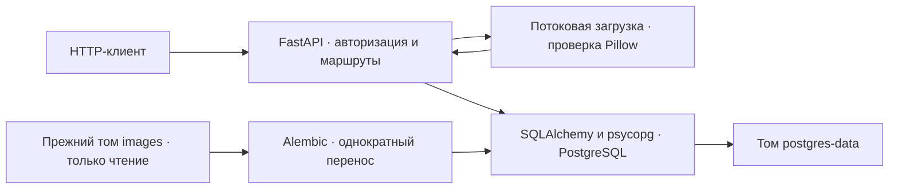

# Архитектурные и технологические решения

Image Storage API хранит исходные JPEG и PNG в PostgreSQL. Клиент обращается к файлам по имени через HTTP. [OpenSpec](openspec/changes/add-image-storage/) содержит контракт, проектные решения и задачи. Команды запуска и примеры запросов приведены в [README](README.md).

## Компоненты

| Компонент | Ответственность |
| --- | --- |
| [app/main.py](app/main.py) | Создаёт FastAPI, регистрирует маршруты и управляет пулом соединений в lifespan. При запуске проверяет доступность базы. |
| [app/config.py](app/config.py) | Читает хеш API-ключа и собирает адрес PostgreSQL. SQLAlchemy кодирует специальные символы пароля при построении адреса. |
| [app/api.py](app/api.py) | Проверяет ключ, имя и объявленный размер. Связывает приём файла, операции базы и HTTP-ответы. |
| [app/storage.py](app/storage.py) | Принимает поток байтов, хранит его во временном файле и проверяет формат и размеры через Pillow. |
| [app/db.py](app/db.py) | Выполняет асинхронные вставку, чтение и удаление. Вставка и удаление завершаются фиксацией транзакции. |
| [app/models.py](app/models.py) и [миграции](alembic/versions/) | SQLAlchemy-модель описывает актуальную таблицу. Alembic создаёт схему и однократно переносит данные файловой версии. |

## Почему PostgreSQL и что хранится в таблице

Первой версии хватало таблицы имён в файловой системе: имя сразу указывало на файл, а том переживал перезапуск. В PostgreSQL имя и содержимое связывает одна строка. Первичный ключ разрешает коллизию между конкурентными загрузками, а транзакция фиксирует байты вместе с именем. Резервная копия базы включает изображения.

Таблица `images` содержит `name` типа `text` с первичным ключом и `content` типа `bytea` с исходными байтами. Ограничение `images_content_size` допускает от 1 байта до 10 МиБ. MIME-тип ответа определяется расширением, которое сверяется с содержимым при загрузке.

## Как выполняются запросы

- Общая зависимость `APIRouter` принимает исходный ключ в `X-API-Key`, вычисляет SHA-256 и сравнивает результат с `API_KEY_HASH` через `hmac.compare_digest`. Клиент хранит исходный ключ. Встроенные маршруты документации отключены.
- В `PUT /images/{name}` клиент выбирает имя и отправляет исходные байты. Перед чтением тела FastAPI проверяет ключ, имя и `Content-Length`. Затем проверяется число фактически полученных байтов, в том числе при потоковой передаче.
- Сервис пишет порции во временный файл и допускает две параллельные проверки Pillow на процесс. Предел в 25 млн пикселей ограничивает объём декодирования. AnyIO переносит синхронные файловые операции и декодирование в рабочие потоки. При выходе из операции файл закрывается в блоке, защищённом от отмены AnyIO.
- После проверки драйвер передаёт целый файл в PostgreSQL. `INSERT … ON CONFLICT DO NOTHING` сохраняет первое изображение по имени. Успешная транзакция даёт `201`, занятое имя — `409`. Загрузка тела остаётся потоковой, а поле `bytea` целиком помещается в память при записи и чтении.
- `GET` считывает байты и возвращает их вложением. Соединение освобождается перед отправкой тела. Если другой запрос удалит запись после чтения, уже подготовленный ответ сохранит исходные байты. `DELETE` удаляет строку и возвращает `204`. Для отсутствующей записи обе операции возвращают `404`.

## Миграции и запуск

[Docker Compose](docker-compose.yml) запускает PostgreSQL 17 во внутренней сети, ждёт готовности базы и запускает API на `127.0.0.1:8000`. [Dockerfile](Dockerfile) запускает контейнер приложения с UID 10001. Перед Uvicorn выполняется `alembic upgrade head`.

Первая миграция создаёт таблицу. Вторая считывает файлы из тома `images`, смонтированного только для чтения. Она переносит исходные байты, пропускает временные файлы и символические ссылки и обрабатывает только допустимые имена. Данные PostgreSQL лежат в томе `postgres-data`. Оба тома переживают обычный `docker compose down`.

Python 3.13 используется в разработке и контейнере. uv устанавливает зависимости из [uv.lock](uv.lock). Ключ и пароль базы задаются через `.env`, исключённый из Git и контекста сборки. [pytest и HTTPX](tests/) проверяют маршруты и конкурентные операции с настоящим PostgreSQL в отдельной тестовой схеме.

## Подтверждённые ограничения

- Pillow может принять JPEG с преждевременно оборванными данными скана. Текущая версия возвращает `201` вместо ожидаемого `415`.
- Расхождение между заявленным и фактическим числом кадров APNG может привести к сохранению файла сверх лимита пикселей.
- Пауза между порциями тела удерживает запрос и временный файл. Ошибки записи на диск или в PostgreSQL могут приводить к `500`.
- HTTP-сервер удаляет краевые пробелы из заголовка. Генератор из README выдаёт ключ в URL-safe формате без пробелов.
