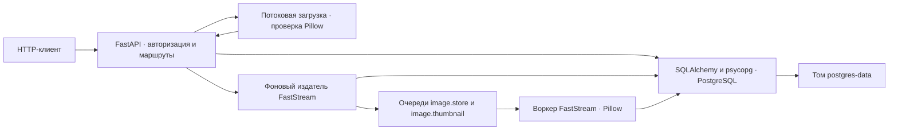

# Архитектурные и технологические решения

Image Storage API хранит исходные JPEG и PNG в PostgreSQL. Клиент обращается к файлам по имени через HTTP. [Текущий контракт загрузки](openspec/specs/async-image-uploads/spec.md) и [контракт миниатюр](openspec/specs/image-thumbnails/spec.md) описаны в OpenSpec. Команды запуска и примеры запросов приведены в [README](README.md).

## Компоненты

| Компонент | Ответственность |
| --- | --- |
| [app/main.py](app/main.py) | Создаёт FastAPI, регистрирует маршруты и управляет пулом соединений и фоновым издателем в lifespan. При запуске проверяет доступность базы. |
| [app/config.py](app/config.py) | Читает хеш API-ключа и собирает адреса PostgreSQL и RabbitMQ. SQLAlchemy кодирует специальные символы пароля при построении адреса. |
| [app/api.py](app/api.py) | Проверяет ключ, имя и объявленный размер. Связывает приём файла, операции базы и HTTP-ответы. |
| [app/storage.py](app/storage.py) | Принимает поток байтов, хранит его во временном файле и проверяет формат и размеры через Pillow. Создаёт однокадровый PNG для воркера. |
| [app/db.py](app/db.py) | Выполняет асинхронные операции с оригиналами, заданиями публикации и миниатюрами. |
| [app/broker.py](app/broker.py) | Объявляет две очереди и публикует задания, зафиксированные в PostgreSQL. |
| [app/worker.py](app/worker.py) | Сохраняет оригинал и выполняет обработку миниатюры на отдельном подписчике. |
| [app/models.py](app/models.py) и [миграции](alembic/versions/) | SQLAlchemy-модель описывает актуальную таблицу. Alembic управляет схемой PostgreSQL. |

## Почему PostgreSQL и что хранится в таблице

В PostgreSQL имя и содержимое связывает одна строка. Первичный ключ разрешает коллизию между конкурентными загрузками, а транзакция фиксирует байты вместе с именем. Резервная копия базы включает изображения.

Таблица `images` использует имя как первичный ключ. Байты находятся в одном из двух полей `bytea`. Принятый поток хранится в `staged_content`, записанный оригинал — в `content`. Для обоих полей действует предел 10 МиБ. MIME-тип ответа определяется расширением, которое сверяется с содержимым при загрузке.

## Как выполняются запросы

- Общая зависимость `APIRouter` принимает исходный ключ в `X-API-Key`, вычисляет SHA-256 и сравнивает результат с `API_KEY_HASH` через `hmac.compare_digest`. Клиент хранит исходный ключ. Встроенные маршруты документации отключены.
- В `PUT /images/{name}` клиент выбирает имя и отправляет исходные байты. Перед чтением тела FastAPI проверяет ключ, имя и `Content-Length`. Затем проверяется число фактически полученных байтов, в том числе при потоковой передаче.
- Сервис пишет порции во временный файл и допускает две параллельные проверки Pillow на процесс. Предел в 25 млн пикселей ограничивает объём декодирования. AnyIO переносит синхронные файловые операции и декодирование в рабочие потоки. При выходе из операции файл закрывается в блоке, защищённом от отмены AnyIO.
- После проверки `INSERT … ON CONFLICT DO NOTHING` резервирует имя и фиксирует байты с `event_pending`. API отвечает `202` и возвращает адрес статуса `/uploads/{uuid}`. Пока оригинал ожидает записи, статус равен `pending`, а скачивание возвращает `404`. Повторная загрузка занятого имени возвращает `409`.
- После фиксации оригинала статус меняется на `stored`. Скачивание считывает байты и возвращает их вложением после освобождения соединения. `DELETE` возвращает `204`, освобождает имя и делает старый UUID недоступным.

## Как сохраняется оригинал и создаётся миниатюра

1. Фоновый издатель читает ожидающие UUID из PostgreSQL по частичному индексу. Пока `content` пуст, он публикует UUID в `image.store`. Сообщения persistent, очереди durable, публикация использует обязательную маршрутизацию и publisher confirms.
2. Воркер одной транзакцией переносит принятые байты в `content` и выставляет `event_pending` для миниатюры. Издатель сбрасывает флаг только для подтверждённой фазы. Позднее подтверждение записи оригинала сохраняет задание миниатюры.
3. После записи оригинала издатель направляет UUID в `image.thumbnail`. Воркер декодирует первый кадр в рабочем потоке и записывает PNG условным обновлением по UUID. Временная ошибка приводит к повторной доставке. Окончательная ошибка декодирования сохраняет доступ к оригиналу и его статусу.
4. После фиксации воркер подтверждает сообщение. Повторное событие для завершённой или удалённой загрузки не меняет запись. Повторное использование имени создаёт новый UUID.

Доставка выполняется как минимум один раз. При потере тома RabbitMQ подтверждённые сообщения могут быть потеряны, а принятые байты и оригиналы остаются в PostgreSQL.

## Миграции и запуск

[Docker Compose](docker-compose.yml) запускает PostgreSQL 17 во внутренней сети, ждёт готовности базы и запускает API на `127.0.0.1:8000` по умолчанию. Воркер запускается после готовности базы и RabbitMQ. [Dockerfile](Dockerfile) запускает контейнер приложения с UID 10001. Перед Uvicorn выполняется `alembic upgrade head`.

Тома `postgres-data` и `rabbitmq-data` переживают обычный `docker compose down`.

Python 3.13 используется в разработке и контейнере. uv устанавливает зависимости из [uv.lock](uv.lock). Ключ и пароли базы и брокера задаются через `.env`, исключённый из Git и контекста сборки. [pytest и HTTPX](tests/) проверяют маршруты и конкурентные операции с настоящим PostgreSQL в отдельной тестовой схеме.

## Подтверждённые ограничения

- Pillow может принять JPEG с преждевременно оборванными данными скана. Текущая версия может принять такой файл с `202`.
- Расхождение между заявленным и фактическим числом кадров APNG может привести к сохранению файла сверх лимита пикселей.
- Пауза между порциями тела удерживает запрос и временный файл. Ошибки записи на диск или в PostgreSQL могут приводить к `500`.
- HTTP-сервер удаляет краевые пробелы из заголовка. Используйте ключ без пробелов.

## Рекомендации по улучшению

- При требованиях к точности миниатюр сохранять цветовые профили и проверять передачу цвета и прозрачности на 16-битных PNG, палитрах с `tRNS` и APNG с отдельной обложкой.
